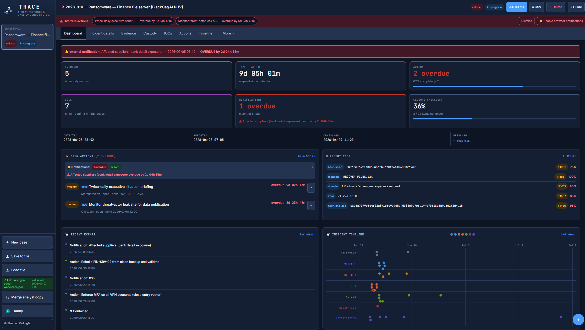

# TRACE — Threat Response & Case Evidence System

A single-file, offline-first incident response case management system for DFIR. Everything runs in your browser — no server, no install, no data leaving your machine.

TRACE helps incident responders manage the full lifecycle of a security incident: evidence and chain of custody, per-host investigation analysis, indicators of compromise with MITRE ATT&CK tagging, response actions with a full completion trail, regulatory notifications, an accurate incident timeline, and structured closure — all aligned to the NIST incident response lifecycle.

---

## Contents

- [What's new](#whats-new)
- [The toolkit](#the-toolkit)
- [Why TRACE](#why-trace)
- [Quick start](#quick-start)
- [Sample cases](#sample-cases)
- [Feature overview](#feature-overview)
- [Actions and the completion trail](#actions-and-the-completion-trail)
- [Host analysis](#host-analysis)
- [Data & privacy](#data--privacy)
- [Saving your work](#saving-your-work)
- [Working as a team](#working-as-a-team)
- [Exports & integrations](#exports--integrations)
- [Companion tools](#companion-tools)
- [Themes](#themes)
- [Browser support](#browser-support)
- [File structure](#file-structure)
- [FAQ](#faq)
- [Disclaimer](#disclaimer)

---

## What's new

### Actions now record when they were completed or updated

Every action keeps a timestamped trail. Marking an action done or cancelled stamps the completion time, and any other change stamps an "updated" time. Each status change (started, completed, cancelled, reopened) is logged, along with who made it. The times appear in the **Actions** tab, on the **Timeline**, in the **incident report** and in the **CSV** export, with a note on whether the action finished on time or how late it was. Completed occurrences of a recurring action are timestamped individually. See [Actions and the completion trail](#actions-and-the-completion-trail).

### Edit actions

Actions can now be edited after creation: title, owner, priority, due date, status, notes and recurrence. Each edit is recorded with what changed (for example *owner: Marcus O → Priya S*) and appears on the timeline.

### Timeline status filter

The **Timeline** has a new **Status** filter — *All events / Open / In progress / Closed* — so you can see at a glance what is still outstanding and what has been closed out. It applies to actions and notifications, and works in both the list and visual views.

### A new report cover page and a visual timeline

- A **cover page** for the incident report: a full-colour page with the case reference, severity, affected systems, key dates, response team and regulatory scope. Choose from **seven colour themes**. It carries a **TLP: RED** marking with a handling line, and the pages after it use a slim running header.
- A dot **timeline strip** sits above the outstanding actions, as a quick visual reference to the incident.
- **Affected systems** is now a field on the Incident details tab. It feeds the cover page and the incident narrative.

### Overdue reminders stay tidy

The overdue / due-soon bar never takes more than two lines. The most overdue actions are shown first, and anything that doesn't fit becomes a **"+N more"** chip — hover to see what's in it, click to jump to Actions.

### A fourth theme — Ember

A warm graphite dark theme with an amber accent. TRACE now offers **Midnight, Daybreak, Console and Ember**.

### TRACE Brief — Interim

A second briefing tool for **live incidents**. Where the original TRACE Brief is the post-incident story, the **Interim Brief** is a situation report: where the investigation stands now, and everything that changed in the last 24 hours, with a visual timeline of the period. See [Companion tools](#companion-tools).

### Two new sample cases

An in-progress **cloud identity compromise** (built for the Interim Brief) and a closed **insider data theft** case. TRACE now ships with six sample cases. See [Sample cases](#sample-cases).

### Earlier releases

- A dedicated **Host analysis** tab, with a professional findings summary for the report and free working notes per host, plus evidence "reviewed" tracking
- **TRACE Brief** — a visual post-incident management briefing
- Section-configurable incident report (PDF / HTML), plus CSV, STIX 2.1 and ATT&CK Navigator export
- Automatic **defanging** of live indicators wherever a human reads them (STIX kept live for machine use)
- **Host-aware duplicate detection**, IOC search/filter, observed-at times, and full 14-tactic ATT&CK coverage
- Delete confirmation and custody-cascade so the record never contains orphaned references

---

## The toolkit

TRACE is the case-management hub, paired with two briefing companions. All are single self-contained HTML files that run entirely offline.

| Tool | File | Role |
|---|---|---|
| **TRACE** | `TRACE-CMS.html` | The incident case-management system — the hub. |
| **TRACE Brief** | `trace-brief.html` | Turns a finished case into a visual management briefing. |
| **TRACE Brief — Interim** | `trace-brief-interim.html` | Turns a live case into a situation report: current position plus the last 24 hours. |

The flow: an incident is identified and a **case opened in TRACE**; evidence, indicators, per-host analysis and decisions are logged as the response runs. While it is live, save the case and run it through the **Interim Brief** as often as you need to update leadership. When the case is closed, produce the formal **report**, then brief the incident in **TRACE Brief**.

---

## Why TRACE

Most incident response tooling is either a heavyweight platform that needs infrastructure and onboarding, or a scattering of spreadsheets and documents that fall out of sync. TRACE sits in between: a single HTML file you can drop onto a workstation, an air-gapped analysis box, or a USB stick, and start logging an incident in seconds.

Because it is one self-contained file with no back end, it is well suited to:

- Sensitive incidents where data must not leave the local machine
- Air-gapped or restricted forensic environments
- Tabletop exercises and training
- Small teams who want structure without standing up a platform

It captures the artefacts that matter for a defensible investigation — evidence integrity hashes, chain of custody, per-host analysis, IOC provenance, action and notification timings, and analyst attribution — and lets you export them in the formats downstream tools expect.

---

## Quick start

1. **Download** `TRACE-CMS.html`.
2. **Open it** in a modern browser (Chrome or Edge recommended — see [Browser support](#browser-support)).
3. Click **New case** and complete the short intake wizard, **or** load a [sample case](#sample-cases) to explore a fully worked example.
4. Click **? Guide** (top right) at any time for an in-app walkthrough.

That's it. There is nothing to install and no account to create.

> **Tip:** For the safest setup, at the start of each incident click **Connect workspace** to link a file on disk (continuous auto-save) and **Set name** to enable analyst attribution.

While an incident is running, open **`trace-brief-interim.html`** and load the saved case file for a situation report. Once it is closed, open **`trace-brief.html`** with the same file for the management briefing.

---

## Sample cases

Six fully worked example cases are included. They are deliberately different in shape, severity and stage, so between them they exercise every feature of the system — useful for evaluating TRACE and for training.

**To load one:** open TRACE, click **Load file** in the sidebar, and select the `.json` file. Loading **merges** the case alongside anything you already have — it will not overwrite your existing work. Each sample uses a distinct case key, so you can load them all together and switch between them in the sidebar.

### 1. Ransomware — `trace-sample-case.json`

**`IR-2026-014` — Akira ransomware on a finance file server.** Critical, still in progress. A fast, loud incident: VPN access without MFA, discovery, credential harvesting, ~340GB exfiltrated, then encryption. **13 IOCs across 7 ATT&CK tactics**, aligned to genuine Akira tradecraft (CISA AA24-109A). Good for seeing the tool under pressure — overdue notifications, open actions, live dwell-time metrics.

### 2. Business email compromise — `trace-sample-case-bec.json`

**`IR-2026-009` — supplier payment diversion.** High, closed. A slow-burn financial fraud via session-token phishing, ~16 days of quiet persistence, then a fraudulent payment. **9 IOCs across 5 tactics**, a de-escalation in the severity log, a fully completed closure checklist and complete lessons learned. Good for seeing a completed case end-to-end.

### 3. Targeted intrusion — `trace-sample-case-apt.json`

**`IR-2026-021` — living-off-the-land espionage at a manufacturer.** Critical, closed. A patient, noisy, ~20-day intrusion across the whole estate. **36 IOCs across 11 tactics and all 9 indicator types**, spanning 12 hosts and sources. Good for a large, complex dataset — the kind that stress-tests the timeline and host views.

### 4. The Gentlemen ransomware — `trace-sample-case-gentlemen.json`

**`IR-2026-031` — RMM supply-chain intrusion.** Critical, closed. A novel initial-access vector: a compromised MSP **remote monitoring & management (RMM)** tool, rather than phishing or VPN. **26 IOCs across 13 tactics**, with TTPs grounded in real-world reporting on The Gentlemen — BYOVD driver abuse (ThrottleBlood.sys / CVE-2025-7771), EDR-killer tooling, GPO abuse for domain-wide staging, WinSCP exfiltration. Includes **5 host analysis entries** (each with a professional summary and working notes), making it the best demonstration of the [Host analysis](#host-analysis) tab.

### 5. Cloud identity compromise (live) — `trace-sample-case-live.json`

**`IR-2026-042` — OAuth token theft in Microsoft 365 / Azure.** High, **in progress**. An adversary-in-the-middle phishing page harvests a session token, bypassing MFA; the actor then persists through a malicious OAuth app, creates a hidden inbox rule and starts staging SharePoint data. **10 IOCs across 8 tactics and 7 hosts**, 2 host analyses, a mix of completed, in-progress and open actions, and overdue notifications.

This sample is built for the **Interim Brief**: its activity is anchored to **29 September 2026, 14:05**, with some — but not all — updates in the final 24 hours. In `trace-brief-interim.html`, set **As of** to that time to see the intended picture. Leaving it on **Now** will show every deadline as long past.

### 6. Insider data theft — `trace-sample-case-insider.json`

**`IR-2026-006` — a departing sales engineer.** Peak severity high, closed at medium. A DLP alert on a 3.8 GB upload to personal cloud storage leads to a deliberate, staged collection of pricing data and 1,840 customer contacts over eight days, taken via a bulk SharePoint download, a CRM export, email forwarding, a USB drive and rclone. An insider case looks different from the others: no malware, valid credentials throughout, and HR and Legal leading from the start. **17 IOCs across 6 tactics**, including USB serial, rclone and anti-forensic artefacts, **5 host analyses**, a severity raise and a de-escalation, an Article 33 decision recorded as not reportable, and root causes that centre on leaver processes. Its **13 actions** show the full completion trail, including one reassigned action with an edit record and a recurring daily check.

---

## Feature overview

TRACE is organised into tabs, aligned to the phases of an incident.

**Dashboard** — an at-a-glance view of the active case: key metrics, a clickable timestamp strip for setting detection/report/containment/resolution times, open action and notification summaries, recent activity, and a mini incident timeline.

**Incident details** — core metadata, narrative, **affected systems**, and severity/status.

**Evidence** — the evidence register. Log each item with type, integrity hash, source, and who collected it and when. Each item can be marked **reviewed**, and the register is filterable.

**Custody** — chain-of-custody entries linked to evidence items, recording each handling event for a defensible audit trail.

**Host analysis** — per-host and per-source investigation notes. See [Host analysis](#host-analysis).

**IOCs** — indicators of compromise with inline **MITRE ATT&CK** technique lookup (search by what you observed — e.g. "powershell", "lsass"). Each IOC records an **observed-at** time so the timeline reflects reality. View as a flat list or grouped **by host**, and filter by value, type, host, MITRE ID or notes. Indicators are **defanged automatically** wherever a human reads them, and adding one that already exists on the same host prompts a duplicate warning.

**Actions** — response tasks with owner, priority, due date, and status, each with a **completed / updated** timestamp. Supports editing, and **recurring** actions with per-occurrence completion tracking. See [Actions and the completion trail](#actions-and-the-completion-trail).

**Timeline** — a unified incident timeline combining evidence, custody, IOCs, actions (due, started, updated, completed), escalations, notifications, and phase milestones. Filter by type and by **status**; switch between list and visual views.

**Reports** — the reporting and export hub. See [Exports & integrations](#exports--integrations).

**More** menu — governance context (including the key stakeholders, such as the incident commander, which can be changed at any point), severity log, notifications tracker, closure checklist, and an IR reference.

### Governance & compliance

- **Notifications tracker** with deadline calculation from detection time, distinguishing regulatory obligations (ICO/UK GDPR, NIS, DORA, and others) from internal and advisory notifications
- **Closure checklist** covering containment, evidence, IOCs, recovery, actions, and notifications
- NIST incident response lifecycle alignment surfaced throughout

### Data integrity

Deleting a record always asks for confirmation and names what's being removed. Deleting an evidence item that has chain-of-custody entries attached warns you and removes those entries too, so the custody record never contains orphaned references to evidence that no longer exists.

---

## Actions and the completion trail

The **Actions** tab is where response work is tracked, and every action carries a record of what happened to it and when.

- **Completed / updated column** — shows *Completed*, *Cancelled* or *Updated* with the time. A completed action also shows whether it was **on time** or **how late**. For recurring actions it shows the last completed occurrence and how many have been done.
- **Status changes are logged** — started, completed, cancelled and reopened, each with the time and the analyst. Reopening an action clears its completion time.
- **Edit an action** — use the pencil icon on any row to change the title, owner, priority, due date, status, notes or recurrence. The edit is recorded with what changed (for example *owner: Marcus O → Priya S*).
- **Recurring actions** — each occurrence is timestamped when it is completed. The most recent completed occurrences stay visible beneath the series, and an occurrence marked done by mistake can be reopened. Completed occurrences keep their original completion time if the schedule is changed later.
- **Where the times appear** — the Timeline shows an event for each status change and edit as well as the due time, the report's *Outstanding actions* and *Full actions log* both carry the column, and the CSV export includes it.

Actions that were already marked done in a case saved before this release show **"time not recorded"** — TRACE can't work out the time after the fact. Anything changed from now on is timestamped.

---

## Host analysis

The **Host analysis** tab is a per-host, per-source investigation workspace — the analytic layer between the raw indicator list and the report. Indicators themselves still live in the IOCs tab; this is where an analyst records *what each system told them*.

Each entry has:

- **Host / log source** — with a dropdown pre-populated from the hosts already seen in your evidence and IOC records, so names stay consistent across the case
- **Analyst** and a **status** (Not started / In progress / Complete)
- **Findings summary** — written professionally; this text is included **verbatim in the incident report**
- **Working notes** — free contemporaneous notes as you work (commands run, dead ends, things to check); kept in the tool and **not exported** to the report
- **Evidence reviewed** — a checklist of the case's evidence items; ticking one marks it reviewed **case-wide**

Because review status lives on the evidence item, the **Evidence tab** shows a Reviewed column, the Host analysis tab shows a progress roll-up ("hosts analysed", "evidence reviewed / outstanding"), and the report shows a review summary — so it's always clear what's still to do.

In the report, each host contributes an **Investigation — host analysis** section: its status, analyst, findings summary and the evidence it covered. This is the analytic narrative that sits between the evidence register and the indicators.

Timings and details entered here stay local to this tab and the report — they don't feed the dashboard metrics or the incident timeline.

---

## Data & privacy

TRACE runs **entirely in your browser**. There is no server and no telemetry — nothing you enter is transmitted anywhere. Your data lives in two places:

1. **Browser storage** — TRACE automatically mirrors your work to local browser storage on every change, so an accidental tab close or crash will not lose data.
2. **A workspace file** (optional but recommended) — a real `.json` file on your disk that TRACE keeps continuously up to date.

---

## Saving your work

There are two ways to persist a case.

### Connect workspace (recommended)

Links TRACE to a `.json` file on your computer and **auto-saves to it on every change**. Within a second or two of any edit, the file on disk is current.

- Click **Connect workspace** → **Create new** to choose a location, or **Open existing** to resume auto-saving into a file you made earlier.
- A green indicator confirms "Auto-saving to *[file]*" once connected.
- After a full browser restart, click **Connect → Open** once to re-link the file. Between launches you remain protected by browser storage.

The workspace file stores your **entire workspace** — every open case, plus which case and tab you were last on. Reconnecting after a crash restores all of it.

### Save to file

A one-time snapshot export — useful for handing someone a copy, archiving a point-in-time state, or moving a case between machines. This is also the file you give to the Brief tools.

> **Note on workspace auto-save:** The **Connect workspace** feature relies on the File System Access API, currently supported only in **Chromium-based browsers (Chrome, Edge, Opera, Brave)**. In Firefox and Safari this option is hidden, but TRACE still works fully via browser storage plus manual **Save to file** / **Load file**.

---

## Working as a team

TRACE supports multi-analyst incidents without needing a shared server.

### Analyst identity

Click **Set name** to record your name and pick an avatar colour. Every record you add is **stamped** with who added it and when, so on a shared case you can see who logged what.

### Merge analyst copy

Each analyst works on their own copy of a case; one person then clicks **Merge analyst copy** and selects a colleague's file. TRACE **combines** the two intelligently:

- New records from their copy are **added** to yours
- Where both edited the same record, the **most recently edited version wins**
- Completed recurring occurrences (with their completion times), closure items and "notification sent" flags are **combined**

Nothing is overwritten destructively. The merge is safe to run repeatedly and accumulates correctly across multiple analysts.

---

## Exports & integrations

All exports live together in the **Reports** tab, each showing what it will contain before you generate it.

| Export | Format | Use |
|---|---|---|
| **Incident report** | PDF / HTML | A formatted report for stakeholders, with a cover page. Choose exactly which sections to include and the cover colour; preview before generating |
| **CSV** | Single spreadsheet | All artefacts flattened into one file, including action completion times |
| **STIX 2.1** | JSON bundle | Share indicators with threat-intel platforms, MISP, or partners |
| **ATT&CK Navigator** | Navigator layer JSON | Visualise tagged techniques on the MITRE ATT&CK matrix |
| **JSON** | TRACE workspace | Full-fidelity backup, sharing, and the basis for the merge workflow and the Brief tools |

### The incident report

The report opens with a **cover page** — case reference, severity, affected systems, key dates, response team and regulatory scope — in one of **seven colour themes**, marked **TLP: RED** with a handling line. The body follows with an executive summary, incident narrative, notification status, a **dot timeline of the incident**, outstanding actions (with last-updated times), and recommendations. A technical appendix then carries the indicators, evidence register, per-host investigation summaries, chain of custody, severity log, full actions log (with completion times) and lessons learned. Each section can be switched on or off.

The CSV export uses proper quoting/escaping and a UTF-8 byte-order mark so it opens cleanly in Excel. STIX and Navigator exports use standard STIX tactic shortnames and are pinned to the current ATT&CK version.

**A note on defanging:** IOC values are defanged in the incident report and CSV, since those are read and shared by people. **STIX exports keep raw, live values** — a defanged pattern would be invalid in a downstream platform. If you use the CSV as an import path into tooling, re-fang the values first.

---

## Companion tools

Working an incident and explaining one are different jobs. Both Brief tools read a case `.json` saved from TRACE, build visual, narrative-led views from it, and run entirely offline. They only read the file — they never write back — so they are safe to hand to someone outside the response team.

### TRACE Brief — post-incident briefing (`trace-brief.html`)

Turns a **finished** case into a management briefing for an executive, a board, a client, a regulator or a lessons-learned session.

Drop in a case file and it builds six ordered views: an **executive summary** (verdict, impact, dwell time, what's outstanding), a **key-facts** infographic, an **attack progression** along the ATT&CK kill chain, an **IOC timeline**, **host swimlanes**, and a **techniques** breakdown. Metrics like dwell time are derived from the case data, not re-entered.

### TRACE Brief — Interim (`trace-brief-interim.html`)

Turns a **live** case into a concise, visual situation report: where the investigation stands now, and everything that has happened recently.

- **As of and window** — choose the moment you are reporting at, and the period to cover: the last **12, 24, 48 or 72 hours**, or **since a chosen time** such as your last briefing. **Mark briefed** remembers the time for next round.
- **Headline** — a one-line summary of the current phase, severity, indicators found, and open actions
- **Needs attention** — overdue and soon-due actions and notifications at a glance
- **What changed** — severity moves, phase changes, new tactics, new hosts or sources, and completed host analyses
- **Timeline** — a visual of the period: a bar chart of how busy each stretch was, above a lane for each type of event (indicators, actions, evidence, custody, notifications and more). Hover any point for detail.
- **Activity and position** — a feed of every change in the window, current counts, and outstanding actions and notifications
- **Copy as text** — a plain-text SITREP to paste into Slack, Teams or email, and **Print / PDF** for a page to hand over

The report is rebuilt as of the time you choose, using the recorded timestamps, so setting an earlier **As of** shows the position at that moment rather than today's. Records saved without history, for example actions completed before action timestamps existed, fall back to their saved state.

---

## Themes

TRACE cycles its **Theme** button through four options; your choice is remembered:

- **Midnight** *(default)* — dark navy security-console aesthetic
- **Daybreak** — a warm, muted light theme
- **Console** — a green-on-black terminal look
- **Ember** — warm graphite with an amber accent, low-glare for long shifts

Both Brief tools offer Midnight, Daybreak and Console.

---

## Browser support

TRACE works in any modern browser, but a few features rely on the **File System Access API**:

- **Connect workspace** (continuous auto-save to a disk file) requires a **Chromium-based browser** (Chrome or Edge).
- In browsers without this API (Firefox, Safari), TRACE still works fully — it falls back to browser storage plus manual **Save to file** / **Load file**.

Everything else — all tabs, exports, themes, merge, the sample cases, and both Brief tools — works everywhere.

---

## File structure

| File | Description |
|---|---|
| `TRACE-CMS.html` | The main application — a single self-contained HTML file. This is all you need to run TRACE. |
| `trace-brief.html` | The post-incident briefing companion — turns a finished case into management-facing visuals. |
| `trace-brief-interim.html` | The interim briefing companion — a situation report for a live case, with a 24-hour timeline. |
| `trace-sample-case.json` | Sample 1 — Akira ransomware, critical, in progress. |
| `trace-sample-case-bec.json` | Sample 2 — business email compromise, high, closed. |
| `trace-sample-case-apt.json` | Sample 3 — living-off-the-land espionage, critical, closed. |
| `trace-sample-case-gentlemen.json` | Sample 4 — The Gentlemen ransomware (RMM supply-chain), critical, closed, with host analysis. |
| `trace-sample-case-live.json` | Sample 5 — cloud identity compromise, high, in progress. Built for the Interim Brief. |
| `trace-sample-case-insider.json` | Sample 6 — insider data theft, closed, with a full action completion trail. |
| `docs/trace-dashboard.PNG` | Dashboard preview image used in this README. |
| `README.md` | This guide. |

The application is a single file with no build step and no external dependencies beyond a web font loaded from Google Fonts (it degrades gracefully to system fonts offline).

---

## FAQ

**Do I need to install anything or run a server?**
No. Open `TRACE-CMS.html` in a browser and you're running.

**Is my data sent anywhere?**
No. Everything stays in your browser and, if you connect a workspace, in a file on your own disk.

**Will loading a sample case overwrite my work?**
No — loading and merging combine cases; they never destructively replace your existing cases. You can load all six samples at once.

**Why do some completed actions say "time not recorded"?**
Completion times are captured from now on. Actions marked done in a case saved before this feature existed have no recorded time, and TRACE doesn't guess one. Reopen and re-complete the action if you want a time recorded.

**What's the difference between the Evidence tab and Host analysis?**
Evidence is the register of items you've collected (with hashes and custody). Host analysis is where you write up what each host or source *told you* during the investigation, and mark which evidence you've reviewed. The two are linked — reviewing an evidence item in Host analysis marks it reviewed on the Evidence tab too.

**What's the difference between the incident report and the Brief tools?**
The report is the formal written record — narrative, tables, sections you choose, suitable for a case file or a regulator. The Briefs are visual explanations for people who weren't in the response: the **Interim Brief** while the incident is live, **TRACE Brief** once it is closed. Most incidents warrant all three.

**When should I use the Interim Brief rather than TRACE Brief?**
Use the Interim Brief while the incident is open, to update leadership on the current position and what has changed. Use TRACE Brief after closure, to tell the finished story. Both read the same saved case file.

**Why does the live sample look so overdue in the Interim Brief?**
It is anchored to 29 September 2026 at 14:05. Set **As of** to that time. On **Now**, every deadline in the sample is long past.

**Do the Brief tools change my case data?**
No. They only read the file you give them, so you can hand them to someone outside the response team without any risk to the record.

**Why are IOCs shown with brackets in them?**
That's defanging — it stops live indicators being clicked accidentally or detonated by a mail gateway when a report is shared. STIX exports keep the real values.

**Can several people work on one incident?**
Yes. Each analyst keeps their own copy and one person merges the others in with **Merge analyst copy**. Records are attributed to whoever added them.

**Which browser should I use?**
Chrome or Edge for the full experience (including workspace auto-save). Others work with manual save/load.

---

## Disclaimer

TRACE is a case-management and record-keeping aid, and the TRACE Brief tools are presentation aids for the data it holds. They do not provide legal advice. Regulatory notification deadlines and obligations shown in the tools are aids to tracking and must be verified against the applicable regulations and your organisation's legal counsel for any real incident. You are responsible for the security and handling of the case data you enter and export.

### No warranty & data-loss disclaimer

The tools are provided **"as is", without warranty of any kind**, express or implied, including but not limited to warranties of merchantability, fitness for a particular purpose, and non-infringement. You use them entirely at your own risk.

Because they store data in your browser and in local files that **you** are responsible for managing, **the authors and contributors accept no liability for any loss, corruption, or inaccessibility of your data** — however it occurs, including (but not limited to) browser storage being cleared, a lost or overwritten workspace file, a browser or system crash, an unsaved session, a failed import or merge, or user error. There is no server-side backup and no way for anyone to recover data on your behalf.

**You are solely responsible for backing up your case data.** Export regularly using **Save to file**, keep copies of your workspace `.json` files in secure, backed-up storage, and do not rely on browser storage as your only copy. In no event shall the authors or contributors be liable for any direct, indirect, incidental, or consequential damages arising from the use of this software or the loss of any data created with it.

---

## Usage & distribution

TRACE and the TRACE Brief tools are free to use and free to share. You may download, use, copy, and distribute them at no charge, including within your organisation and to others, provided they remain **free of charge** and this notice and the accompanying disclaimers are kept intact. You may **not sell, resell, license for a fee, or otherwise commercialise** any of the tools, or any substantially unmodified version of them, whether on their own or bundled as part of a paid product or service. If you share them, share them freely.
